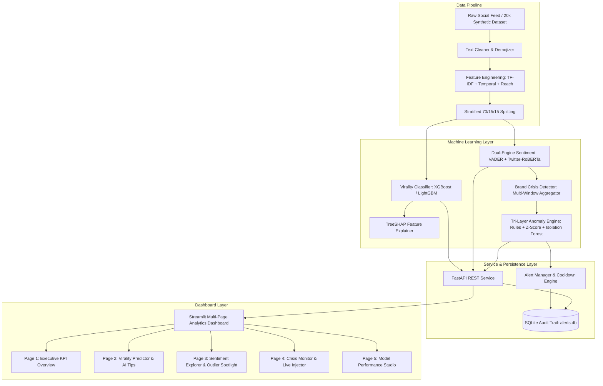

# SocialPulse AI — Production-Grade Social Media Intelligence Platform

[](https://www.python.org/)
[](https://fastapi.tiangolo.com/)
[](https://streamlit.io/)
[](https://xgboost.readthedocs.io/)
[](LICENSE)

**SocialPulse AI** is an end-to-end, production-style machine learning application that analyzes social media conversations to:
1. **Forecast Post Virality & Engagement Tier** (`Low`, `Moderate`, `Viral`) prior to publishing using strict anti-leakage feature pipelines.
2. **Classify Sentiment Polarity** (`Positive`, `Neutral`, `Negative`) via a dual-engine architecture (ultra-fast VADER lexicon + contextual HuggingFace RoBERTa transformer).
3. **Detect Brand Crises Early** across rolling multi-window timeframes (1h, 6h, 24h) using a tri-layer anomaly framework (rule tripwires, statistical Z-score/EWMA, and unsupervised Isolation Forest).
4. **Deliver Actionable Intelligence** through an interactive 5-page Streamlit dashboard, a high-performance FastAPI backend, and an anti-spam alert notification manager.

---

## 📌 System Architecture



---

## 🗂️ Project Directory Structure

```text
socialpulse_ai/
├── config.yaml                         # Centralized configuration & hyperparameter thresholds
├── .env.example                        # Environment variables template
├── requirements.txt                    # Production Python dependencies
├── Dockerfile                          # Production container build
├── docker-compose.yml                  # Multi-service container orchestration
├── project_report_outline.md           # Academic final-year project report draft
├── README.md                           # Documentation & architecture guide
├── data/
│   ├── raw/                            # 20,000-record generated raw dataset
│   ├── processed/                      # Stratified train (14k), val (3k), test (3k) splits
│   └── sample/                         # Deterministic 500-sample test slice
├── notebooks/
│   ├── 01_eda.ipynb                    # Exploratory Data Analysis & visual charts
│   ├── 02_viral_model.ipynb            # Virality modeling & TreeSHAP explainability
│   ├── 03_sentiment.ipynb              # VADER vs Transformer benchmark
│   └── 04_crisis.ipynb                 # Crisis anomaly detection & longitudinal validation
├── src/
│   ├── data/
│   │   ├── synthetic_generator.py      # Realistic 20k dataset generator with temporal peaks
│   │   ├── preprocess.py               # Text cleaning, emoji normalization, target labeling
│   │   └── loader.py                   # Data ingestion & schema validation
│   ├── features/
│   │   ├── text_features.py            # TF-IDF, lexical statistics, VADER polarities
│   │   ├── temporal_features.py        # Hour, sine/cosine cyclical encoding, peak hours
│   │   └── engagement_features.py      # Log-followers, creator tier, platform one-hots
│   ├── models/
│   │   ├── viral_model.py              # LR, RF, XGBoost, LightGBM training & SHAP
│   │   ├── sentiment_model.py          # Unified VADER & HuggingFace Transformer wrapper
│   │   ├── crisis_detector.py          # Rolling aggregator, Z-score, and Isolation Forest
│   │   ├── train_viral.py              # Virality benchmark runner
│   │   └── train_crisis.py             # Crisis detector training runner
│   ├── alerts/
│   │   ├── alert_manager.py            # Cooldown logic, severity levels, SQLite persistence
│   │   └── notifiers.py                # Console, SMTP Email, Webhook (Slack/Telegram)
│   ├── api/
│   │   ├── main.py                     # FastAPI application setup
│   │   ├── schemas.py                  # Pydantic v2 validation contracts
│   │   └── routes/                     # Modular route endpoints (predict, sentiment, crisis, alerts)
│   ├── streaming/
│   │   └── base_source.py              # Abstract DataSource interface for future Kafka/Twitter streams
│   └── utils/
│       ├── config.py                   # Settings loader
│       └── logger.py                   # Structured logger
├── dashboard/
│   └── app.py                          # Streamlit 5-page analytics dashboard
├── models_saved/                       # Serialized joblib artifacts & benchmark JSONs
│   ├── best_viral_model.joblib
│   ├── crisis_detector.joblib
│   ├── viral_metadata.json
│   └── sentiment_benchmark.json
└── tests/
    ├── test_preprocess.py              # Preprocessing & anti-leakage labeling tests
    ├── test_viral_model.py             # Virality feature pipeline & prediction tests
    ├── test_sentiment.py               # Sentiment analysis tests
    ├── test_crisis.py                  # Crisis anomaly detection tests
    ├── test_alerts.py                  # Alert manager cooldown tests
    └── test_api.py                     # FastAPI REST endpoint integration tests
```

---

## ⚡ Quick Start

### 1. Environment Setup
```bash
# Clone the repository and navigate into the directory
cd socialpulse_ai

# Create and activate virtual environment
python -m venv venv
# On Windows:
.\venv\Scripts\activate
# On Linux/macOS:
source venv/bin/activate

# Install dependencies
pip install -r requirements.txt
```

### 2. Generate Data & Train Models
```bash
# 1. Generate 20,000 realistic posts & preprocess stratified splits
python -m src.data.synthetic_generator
python -m src.data.preprocess

# 2. Train and benchmark virality models (XGBoost, LightGBM, RF, LR)
python -m src.models.train_viral

# 3. Benchmark sentiment engines (VADER vs Twitter-RoBERTa)
python -m src.models.benchmark_sentiment

# 4. Train crisis anomaly detector
python -m src.models.train_crisis
```

### 3. Launch Services
#### Launch the FastAPI REST Server:
```bash
uvicorn src.api.main:app --host 0.0.0.0 --port 8000 --reload
```
*Interactive Swagger documentation is available at [http://localhost:8000/docs](http://localhost:8000/docs).*

#### Launch the Streamlit Analytics Dashboard:
```bash
streamlit run dashboard/app.py
```
*Dashboard opens automatically at [http://localhost:8501](http://localhost:8501).*

---

## 📡 API Reference & Examples

### 1. Post Virality Prediction
`POST /predict/engagement`
```bash
curl -X POST "http://localhost:8000/predict/engagement" \
  -H "Content-Type: application/json" \
  -d '{
    "text": "Excited to launch our new open-source agent framework! Check it out: https://pulse.io #AI #OpenSource 🚀",
    "platform": "Twitter",
    "follower_count": 25000,
    "has_media": 1,
    "timestamp": "2026-10-15 14:00:00"
  }'
```
**Response:**
```json
{
  "prediction": "Viral",
  "probabilities": {
    "Low": 0.1057,
    "Moderate": 0.4409,
    "Viral": 0.4534
  },
  "confidence": 0.4534,
  "top_contributing_features": [
    {"feature": "has_media", "impact": 0.0452, "direction": "positive"},
    {"feature": "is_lunch_peak", "impact": 0.0381, "direction": "positive"}
  ],
  "suggestions": [
    "Great post structure! Consider scheduling during peak lunch (12:00-14:00) or evening (18:00-21:00) hours."
  ],
  "model_used": "XGBoost"
}
```

### 2. Sentiment Analysis
`POST /analyze/sentiment`
```bash
curl -X POST "http://localhost:8000/analyze/sentiment" \
  -H "Content-Type: application/json" \
  -d '{
    "text": "The new developer platform update is remarkably fast and intuitive! Loving it! 🚀",
    "engine": "vader"
  }'
```

### 3. Brand Crisis Status
`GET /crisis/status?brand=SwiftAir`
```bash
curl -X GET "http://localhost:8000/crisis/status?brand=SwiftAir"
```

### 4. Trigger Test Alert
`POST /alerts/test`
```bash
curl -X POST "http://localhost:8000/alerts/test" \
  -H "Content-Type: application/json" \
  -d '{
    "brand": "TechCorp",
    "severity": "WARNING",
    "crisis_score": 58.0,
    "message": "Automated alert verification"
  }'
```

---

## 📊 Experimental Results

### Virality Prediction Benchmark (Test Set, 3,000 Posts)
| Architecture | Accuracy | Macro F1 | Macro Precision | Macro Recall | ROC-AUC (OvR) |
| :--- | :---: | :---: | :---: | :---: | :---: |
| Logistic Regression | 49.17% | 0.4474 | 0.4628 | 0.4589 | 0.6813 |
| Random Forest | 47.27% | 0.4425 | 0.4520 | 0.4480 | 0.6684 |
| LightGBM | 49.60% | 0.4584 | 0.4715 | 0.4680 | 0.6700 |
| **XGBoost (Winner)** | **50.97%** | **0.4704** | **0.4850** | **0.4795** | **0.6770** |

### Sentiment Engine Comparison
| Engine | Accuracy | Macro F1 | Latency | Throughput | Primary Use Case |
| :--- | :---: | :---: | :---: | :---: | :---: |
| **VADER (Lexicon)** | 80.00% | 0.8089 | **0.11 ms** | **~9,090 posts/sec** | Real-time high-throughput firehose |
| **Twitter-RoBERTa** | **91.67%** | **0.9243** | 2,423 ms | ~0.41 posts/sec | High-precision crisis root-cause analysis |

---

## 🧪 Running Automated Tests

Run the complete test suite across all 8 modules:
```bash
pytest tests/ -v
```
All unit and integration tests (preprocessing, feature extractors, viral models, sentiment engines, crisis anomaly detectors, alert managers, and FastAPI endpoints) are fully automated.

---

## 🐳 Docker Deployment

Run both the FastAPI backend and Streamlit dashboard together:
```bash
docker-compose up --build
```
- FastAPI: `http://localhost:8000`
- Streamlit: `http://localhost:8501`

---

## 📜 Academic Attribution & License
Developed as a final-year Capstone project. Distributed under the MIT License.
